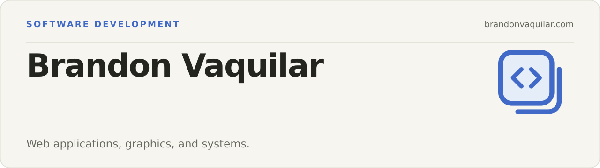

I build web applications and work with C++ graphics and ARM assembly. The projects below include real output previews, source code, and reproducible build steps.

[Portfolio](https://brandonvaquilar.com) · [LinkedIn](https://www.linkedin.com/in/brandon-vaquilar) · [Contact](https://brandonvaquilar.com/contact/)

## Selected work

<table>
<tr>
<td width="50%" valign="top">

### C++ / OpenGL Game Engine

**Personal engine prototype · C++ · OpenGL · CMake**

Shared texture, scrolling, timing, and collision systems. A kart-platformer demo brings the engine together across three scenes.

[Source and build instructions](https://github.com/BrandonVaquilar/Blue-Hedgog-Kart-Platformer) · [Demo screenshots](https://github.com/BrandonVaquilar/Blue-Hedgog-Kart-Platformer#platformer-demo-gallery)

</td>
<td width="50%" valign="top">

### ARM32 Systems Lab

**Systems coursework · ARM32 · C · C++ · QEMU**

Image filters, greedy terrain traversal, and a small BASIC-to-assembly compiler, with real output previews and regression checks.

[Source and build instructions](https://github.com/BrandonVaquilar/Computer-Organization-and-Assembly-Language-Programming) · [Output gallery](https://github.com/BrandonVaquilar/Computer-Organization-and-Assembly-Language-Programming#output-previews)

</td>
</tr>
</table>

## Tools I use

| Web | Graphics and systems | Development |
| --- | --- | --- |
| React, TypeScript, HTML, CSS | C++, C, OpenGL, ARM assembly | Git, Linux, CMake, Make, QEMU |

## Get in touch

Use the [contact form on my portfolio](https://brandonvaquilar.com/contact/) for opportunities or questions about my work.
